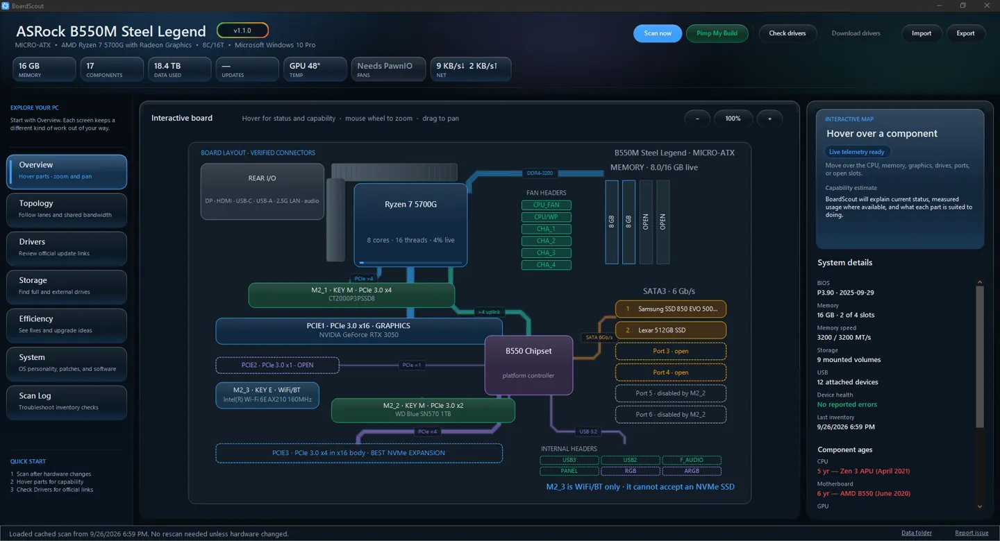
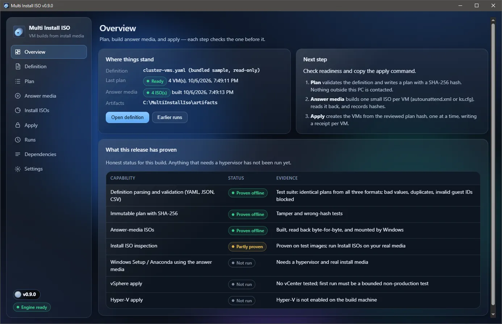

I automate everything that ships or breaks: deployments, releases, certificates, failovers, hardware and software. If a human has to remember the steps, I'm not done yet.

20+ years in enterprise infrastructure, 10+ of them in DevOps and automation, mostly across Azure, AWS and the Windows systems underneath them.

**[Portfolio](https://mikedopp.github.io)** · **[LinkedIn](https://www.linkedin.com/in/mikedopp)** · **[Email](mailto:mikedopp@mikedopp.com)** · **[Profile](https://github.com/mikedopp/Profile)**

## Public work

<table>
<tr>
<td width="50%" valign="top">

<h3><a href="https://github.com/mikedopp/BoardScout">BoardScout</a></h3>
Maps a PC's motherboard, bandwidth, drivers, storage and OS in one portable app, and flags hardware running below spec, like a PCIe 4.0 SSD on 3.0 lanes. Read-only: it never installs drivers.
  
<code>C#</code> <code>.NET 10</code> <code>Windows + Linux</code> <code>MIT</code> 
17 public releases since August 2026, checksummed since 1.1.
</td>
<td width="50%" valign="top">

<h3><a href="https://github.com/mikedopp/Multi_Install_ISO">Multi_Install_ISO</a></h3>
Builds vSphere and Hyper-V servers straight from install ISOs, with no templates or golden images. Every build follows a hashed plan, a gated apply and a receipt for each step.
  
<code>PowerShell</code> <code>.NET 10</code> <code>vSphere</code> <code>Hyper-V</code> 
0.9.1 prerelease. Planning and answer media are proven offline; the live-host apply is not yet.
</td>
</tr>
</table>

## Toolbox

**Delivery** Azure DevOps · YAML pipelines · Octopus Deploy · TeamCity · Git · GitHub 
**Reliability** High availability · failover automation · SQL Server Always On · Azure Monitor · Datadog · Dynatrace 
**Cloud** Azure · AKS · AWS · Docker · ARM · Bicep 
**Security** PKI and TLS · certificate lifecycle · Key Vault · secrets management 
**Automation** PowerShell 7 · Python · C#/.NET · Bash · SQL · REST APIs 
**Applied AI** RAG · embeddings · vector search · Ollama · AI coding agents with human review 
**Infrastructure** VMware vSphere · PowerCLI · Windows Server · IIS · load balancers
